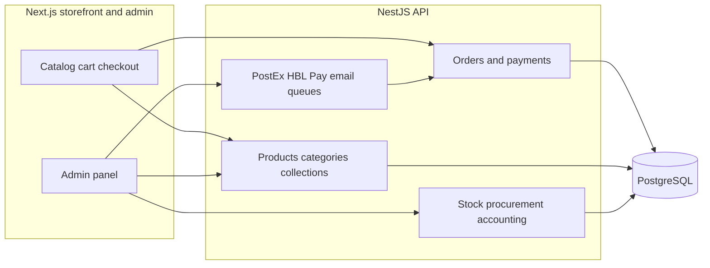

> **Live site** — [bombaychocnnuts.com](https://bombaychocnnuts.com/)

Bombay Choc n Nuts is a Pakistan-based luxury gifting and dry-fruit retailer with roots going back to 1976. The business needed more than a marketing site: customers order online across categories (dry fruits, dates, confectionery, corporate hampers), while operations run on stock, procurement, fulfillment, and finance. I built and maintain the **customer storefront** and **NestJS API**, plus a large **admin panel** embedded in the same Next.js app.

---

## Problem

The brand sells high-trust, high-AOV products with variants, gift packages, and corporate orders. Offline spreadsheets and disconnected tools could not support:

- Real-time stock and order placement without overselling
- Multiple payment paths (COD, bank transfer, online checkout)
- Courier booking and shipment tracking (PostEx)
- Returns, procurement, and double-entry accounting for back office staff
- CMS-style control of homepage sections, blogs, testimonials, and SEO

## Solution overview

A **modular monolith** backend exposes REST APIs for the public site and admin. The frontend is a **Next.js App Router** application: public catalog and checkout on one side, a protected admin area on the other, sharing auth and API clients.

## What I built

### Customer experience

Storefront flows for discovery, trust, and checkout on mobile and desktop.

- Category, brand, and collection browsing with product detail, variants, and wishlists
- Cart and checkout with idempotent order placement and payment-token flows for online pay
- Account area: order history, track order, security settings
- Content pages: about, corporate gifting, blog, FAQ, shipping, returns, contact
- Same-day delivery messaging for Karachi and mobile-first layout

### Commerce and operations

Core API domains that keep catalog, money, and inventory aligned.

- **Orders:** status transitions, item writers, totals, checkout cart signatures, website vs admin controllers
- **Stock:** reservations and movements tied to order lifecycle
- **Payments:** HBL Pay integration; COD and manual methods; success/failure checkout routes on the frontend
- **Logistics:** PostEx module for cities, pickup addresses, shipments, and admin tooling
- **Returns:** order-returns workflow aligned with stock
- **Procurement:** purchases, suppliers/parties, purchase returns
- **Accounting:** chart of accounts, vouchers (cash/bank payment and receipt, journal), and reports (ledger, trial balance, balance sheet, party outstanding)
- **Catalog CMS:** products, groups, attributes, packages, brands, categories, collections, page sections, banners, testimonials, reviews, blogs, SEO meta
- **Platform:** JWT auth, roles/permissions, throttling, Bull queues, scheduled jobs, transactional email templates on order events

### Admin panel

Dozens of focused admin screens mirror backend domains—orders, stock, PostEx, procurement, full accounting, and merchandising—so staff rarely need direct database or third-party UIs.

## Tech stack

| Layer | Choices |
| --- | --- |
| Frontend | Next.js 16, React 19, Tailwind CSS 4, Zustand, Framer Motion, dnd-kit |
| Backend | NestJS 11, TypeORM, PostgreSQL, Swagger, class-validator |
| Infra patterns | Event emitter for emails, Bull for async work, serve-static for uploads |

## Outcomes

> Production at [bombaychocnnuts.com](https://bombaychocnnuts.com/) — one codebase for **retail UX** and **ERP-style back office**, with checkout built for **consistency** (transactions, stock coupling, idempotency) and **local integrations** (PostEx, HBL Pay) on the same order model customers see on the site.

## My role

End-to-end ownership: API design, domain modules, database migrations and seeds, storefront and admin UI, and integration with payment and courier providers. Author on the backend package reflects ongoing maintenance as the catalog and operations grow.
