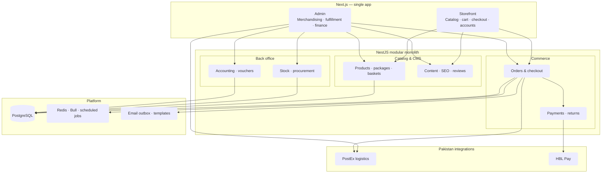

> **Live site** — [bombaychocnnuts.com](https://bombaychocnnuts.com/) · **Status:** production, ongoing development

Bombay Choc n Nuts is a Pakistan-based luxury dry-fruit and gourmet gifting retailer with roots dating back to 1976. The business needed more than a marketing site: customers order premium dry fruits, dates, confectionery, and corporate hampers online, while operations depend on stock, procurement, fulfillment, and finance working as one system.

I built and maintain the **customer storefront** and **NestJS API**, plus a feature-rich **admin panel** in the same **Next.js** app. The goal was a connected platform—not a standalone catalog—where orders, inventory, payments, shipping, procurement, and financial records follow explicit workflows instead of disconnected spreadsheets.

---

## Problem

The brand sells high-trust, high-AOV products with variants, gift packages, and corporate orders. Offline tools could not support:

- Real-time stock and order placement without overselling
- Multiple payment paths (COD, bank transfer, online checkout)
- Courier booking and shipment tracking (PostEx)
- Returns, procurement, and double-entry accounting for back-office staff
- CMS-style control of homepage sections, blogs, testimonials, and SEO

## Solution overview

**Frontend:** one Next.js App Router application with a public storefront and a protected **admin** area, sharing auth and API clients.

**Backend:** a **domain-based NestJS modular monolith**—REST APIs for the website and admin, documented with Swagger (no API versioning yet). Domains are split by business responsibility (products, categories, orders, stock, procurement, accounting, PostEx shipping, users, auth, emails, and supporting modules) rather than deploying separate microservices, which keeps the system maintainable without premature distributed complexity.

### Data layer

PostgreSQL with TypeORM: relational entities, foreign keys, indexes, migrations, seed data for required records, and **database transactions** for operations that must succeed or fail atomically (order placement, inventory reservation, financial posting).

---

## What I built

### Customer experience

Storefront flows for discovery, trust, and checkout on mobile and desktop. The hero cover above is from the live homepage (corporate gifting, category nav, and rotating banners).

*Product listing with filters, variants, and add-to-cart across categories.*

*Gift baskets — empty shells, curated ready-made hampers, or build-your-own within capacity limits.*

**Catalog & shopping**

- Product listing and detail pages; category, brand, and collection browsing with filtering and variants
- SEO-oriented product and category routes; shopping cart and checkout
- **Gift baskets** — empty containers, ready-made hampers, and **custom** baskets with capacity-based product selection
- Online payment via **HBL Pay**; **cash on delivery** and bank/cash settlement paths; dedicated payment success and failure pages

**Accounts & content**

- Registration, login, account management, order history, order tracking, security settings, wishlists
- Corporate gifting, blog, FAQ, shipping and returns policies, contact
- Same-day delivery messaging for Karachi; responsive, mobile-first layout
- Meta Pixel on public routes (excluded from admin and auth screens)

### Admin panel

Centralized operations in the same Next.js app as the storefront.

| Area | Capabilities |
| --- | --- |
| **Catalog & CMS** | Products, attributes, product groups, packages (baskets), brands, categories, collections, page sections and banners, testimonials, reviews, blogs, SEO |
| **Orders & inventory** | Order management, status lifecycle, stock levels, stock movement history, cancellations, returns |
| **Shipping** | PostEx cities and pickup addresses, shipment creation and management, tracking, courier admin tools |
| **Procurement** | Parties (suppliers/customers), purchases, purchase returns, stock and accounting tie-ins |
| **Accounting** | Chart of accounts, vouchers, ledger entries, financial reports including party outstanding |

Dozens of focused screens mirror backend domains so staff rarely need direct database or third-party UIs.

### Order lifecycle

Inventory is **reserved at order creation**, not deferred until dispatch.

**Online payment (HBL)**

1. Customer places an order → created with payment pending.
2. Required stock is reserved inside a DB transaction.
3. Customer completes HBL hosted checkout.
4. On success, payment and order status advance to confirmed; on failure, the customer sees a failure route with order context.

**Cash on delivery**

1. Customer places a COD order → stays pending until admin confirmation.
2. Stock remains reserved while pending.
3. Admin confirms the order in the admin panel to move it forward.

### Inventory & concurrency

The system tracks **on-hand** stock separately from **reserved** quantity tied to open orders.

| Stage | Behaviour |
| --- | --- |
| Order placement | Required quantity reserved |
| Pending order | Reserved stock unavailable to other orders |
| Pending cancellation | Reservation released (negative reserved movements) |
| Dispatch | Reserved quantity consumed from on-hand stock |
| Dispatched cancellation | No automatic stock restoration |
| Delivered return | Quantity added back; refund-side accounting posted in the same flow |

Concurrent checkouts are handled with **database transactions**, **pessimistic row locks**, availability checks, and transaction-safe updates so two customers cannot reserve the same last unit.

Movement history is recorded as **In**, **Out**, and **Reserved** entries for auditability.

### Checkout integrity (API)

- **Server-side pricing** — line items re-priced from the database during placement; client totals are not trusted
- **Idempotency-Key** — retries replay the same order or reconcile via a stored **checkout cart signature**
- **Hashed payment tokens** for secure return URLs from HBL
- **PostEx** — prepaid shipments with zero COD collectable; COD shipments carry the order total for courier collection

### Commerce modules (backend)

- **Orders** — website vs admin controllers, status transition rules, item writers, totals, cart signatures
- **Stock** — reservations, lots, movements, procurement-driven stock-in
- **Payments** — HBL Pay module; extensible online-checkout provider registry (future gateways scaffolded in payment resolution)
- **PostEx** — fulfillment integration aligned with payment method
- **Order returns** — delivered orders only; restock + ledger
- **Procurement** — purchases editable until posted; parties; purchase returns
- **Accounting** — chart of accounts; cash/bank **payment**, cash/bank **receipt**, and **journal** vouchers; posted and reversed statuses; separate **ledger entries** driving reports (general ledger, trial balance, balance sheet, party outstanding, daily, account summary); auto-generated entries from sales, purchases, and returns plus manual vouchers from admin
- **Catalog** — products, variants, stock units, packages, collections, page sections, wishlists, reviews
- **Platform** — JWT access + refresh tokens, admin module-type guards, role permissions on sensitive modules (roles, admins, users, purchases), throttling, health checks, Joi-validated config

### Email & background work

Order and auth flows emit events → **email outbox** rows → **Bull** workers (Redis-backed) → **Handlebars** templates. Types include email verification, password reset, order confirmation, and order status updates, with **idempotent send keys** to avoid duplicate mail on retries. Scheduled jobs and the event emitter handle other async and recurring work; uploads are served via `serve-static`.

### Payment & shipping integrations

**HBL Pay** — hosted checkout, success/failure handling, order confirmation after successful payment.

**PostEx** — city and pickup management, shipment creation and management, tracking, and admin courier operations linked to the order model.

---

## Tech stack

| Layer | Choices |
| --- | --- |
| Frontend | Next.js 16, React 19 (JavaScript), Tailwind CSS 4, Zustand, Framer Motion, React Compiler; dnd-kit for admin page-section ordering |
| Backend | NestJS 11, TypeScript, TypeORM, PostgreSQL, Swagger / OpenAPI, class-validator |
| Infra | Redis + Bull, event emitter, scheduled jobs, serve-static for uploads, Joi env validation |

**Integrations:** HBL Pay · PostEx

---

## Engineering approach

- Domain-oriented modular backend; clear split between storefront and admin
- Relational integrity (FKs, indexes, migrations, seeds)
- Transaction-safe critical paths and explicit order/inventory states
- Reusable frontend components; validated REST APIs with Swagger
- Maintainable integration boundaries (payments, courier)
- Practical async processing—queues and events instead of blocking request threads
- Modular monolith first—organized domains in one deployable API rather than distributed overhead by default

## Engineering highlights

| Challenge | Approach |
| --- | --- |
| Inventory overselling | Transactional reservation + pessimistic locks + in-transaction availability checks |
| Stock across order states | Reservation model, movement audit trail, state-dependent release vs deduct vs return |
| Accounting integrity | Posted vouchers with separate ledger rows; reversals instead of editing posted records; procurement purchases locked after posting |
| Connecting operations | Domain NestJS modules wired through transactions, domain events, queues, and shared order/stock/account models |
| Duplicate checkouts | Idempotency keys + cart-signature matching on replay |

## Outcomes

> Production at [bombaychocnnuts.com](https://bombaychocnnuts.com/) — one codebase for **retail UX** and **operations back office**, with checkout built for **consistency** (transactions, server-side pricing, stock coupling, idempotency) and **local integrations** (PostEx, HBL Pay) on the same order model customers see on the site.

## My role

Full-stack engineer across frontend, backend, database, and integrations:

- Backend modules and REST API design; domain-based architecture
- Relational schema, migrations, and seeds
- Customer storefront and admin business features
- Order, inventory, accounting, and procurement workflows
- HBL Pay and PostEx integrations
- Authentication, authorization, and production maintenance

Author on the backend package reflects ongoing ownership as the catalog and operations grow.
